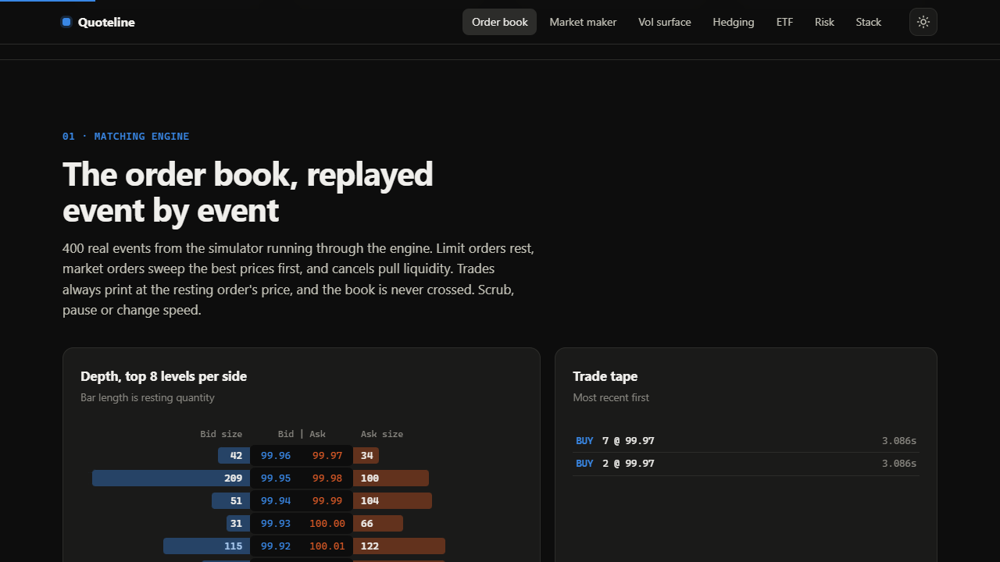
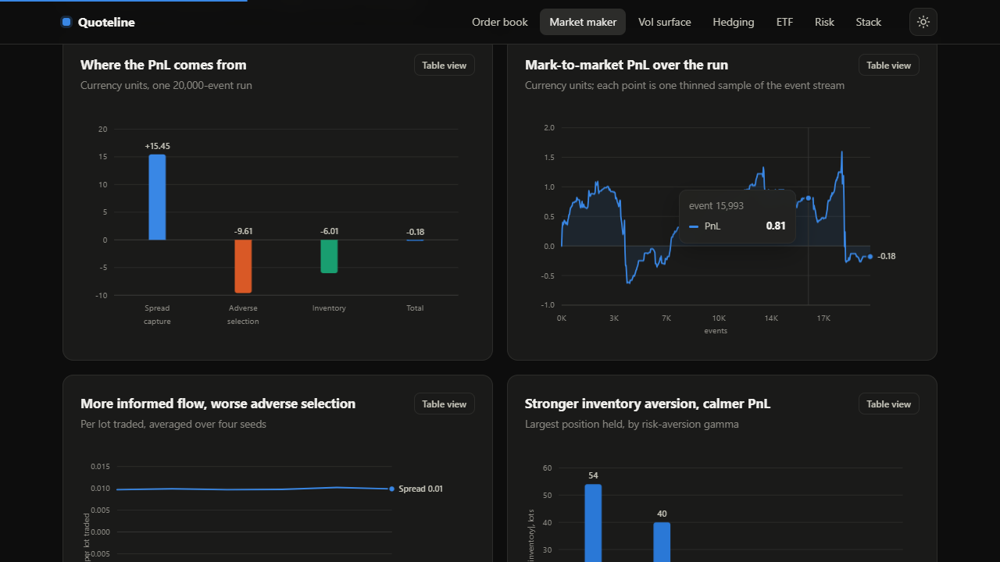
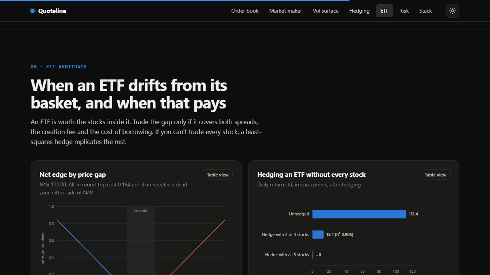
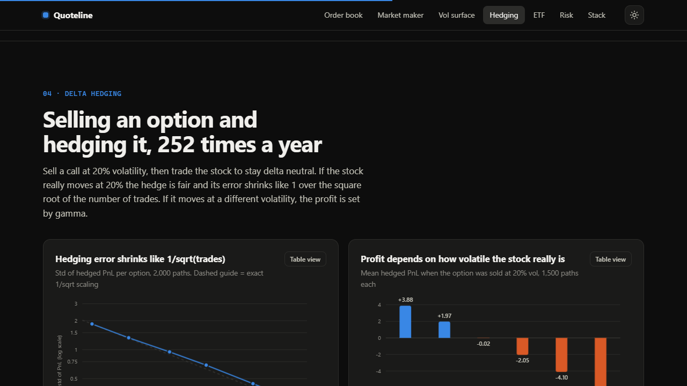
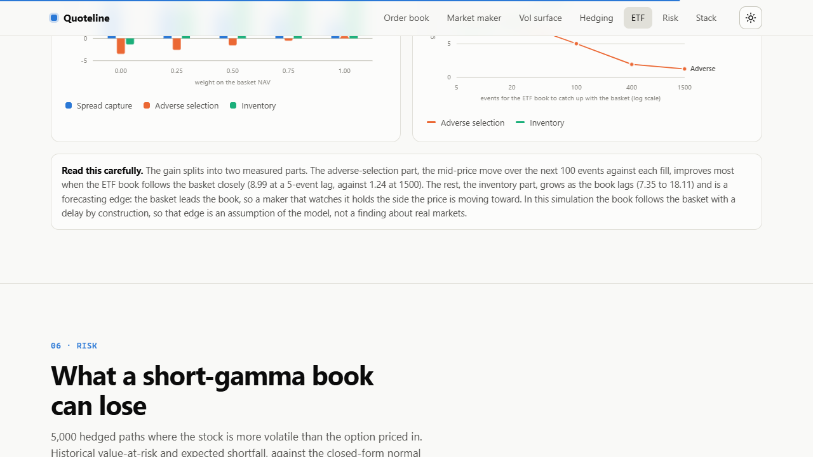

# Quoteline

A limit order book, a market-making lab, an options pricer with a fitted
volatility surface, a delta-hedging simulator and an ETF arbitrage engine,
written in OCaml, with a browser view of the results.

Everything runs on **simulated data**. This is an engineering and research
project; it makes no claim about real-market profit.

Open [`web/index.html`](web/index.html) in a browser (double-click, no server)
to see the engine's output: a replayable order book and every result below as
an interactive chart.



<table>
  <tr>
    <td></td>
    <td></td>
  </tr>
  <tr>
    <td></td>
    <td></td>
  </tr>
</table>

Screenshots come from `web/tests/record.mjs`, which also records a short tour
video (not committed; it is a few MB).

## What is in it

| Part | What it does | Where |
|---|---|---|
| Order book | Price-time priority matching, limit / market / IOC / cancel, trades at the resting price | `lib/book` |
| Simulator | Seeded event stream with a hidden fundamental price, informed traders and per-order lifetimes. Same seed, same bytes | `lib/sim` |
| Market maker | Avellaneda-Stoikov quoting, post-only, inventory limits; PnL split into spread / adverse selection / inventory | `lib/mm` |
| Options | Black-Scholes and Greeks, implied vol, SVI surface fit with a butterfly-arbitrage check, delta hedging | `lib/options` |
| ETF | NAV and creation/redemption arbitrage signal with all-in costs; least-squares partial-basket hedge; a three-stock market where the ETF has a real order book and a maker can quote around the basket | `lib/etf` |
| Risk | Historical and normal VaR and expected shortfall | `lib/risk` |
| Research (Python) | Independent re-implementations used as cross-checks | `research/` |
| Web view | Plain HTML/CSS/JS, no framework | `web/` |

Prices are integer ticks and quantities are non-negative by construction
(abstract `Price.t` and `Qty.t`), so the engine never touches floating point and
a negative size cannot be represented.

## Results, and how each was checked

### The matching engine agrees with an independent implementation

`research/reference_book.py` is a deliberately naive order book (plain lists,
linear scans) written with no shared code. Replaying the simulator's 20,000
events through it produces **exactly the same 3,315 trades** as the OCaml
engine: same takers, makers, prices and quantities, in the same order. The book
is never crossed at any step.

The checker can fail: corrupting the expected trades by one tick, one lot, a
swap or a deletion is caught at exactly the corrupted index every time.

### Option prices and Greeks agree with Monte Carlo

`research/mc_options.py` prices five options by simulation (antithetic
variates, pathwise derivatives), using only the standard library. All 20
comparisons (price, delta, vega, rho for five options) land within 4 standard
errors of the OCaml closed form; the largest |z| was 2.33. A separate run over
30 independent seeds put the mean z-scores within 1.6 standard errors of zero,
so there is no systematic bias.

### The market maker's edge is small but positive in this simulator

One backtest is one path, and the path shown first on the web page (seed 42)
ended at **-0.18**. Over **24 independent seeds** the picture differs:

| Component | Mean | 95% bootstrap interval |
|---|---|---|
| Spread capture | +11.23 | [+10.63, +11.80] |
| Adverse selection | -6.63 | [-7.07, -6.18] |
| Inventory | -3.06 | [-3.54, -2.59] |
| **Total** | **+1.54** | **[+0.88, +2.15]** |

19 of 24 seeds were profitable. The Python bootstrap in
`research/bootstrap_pnl.py` gives the same mean and an interval of
[+0.885, +2.151]. The three components sum to the total on every seed to
1e-15.

Read this as a demonstration of the mechanism. The informed traders, their news
and the order-flow parameters are my own assumptions, and there is no latency,
fee or queue-position model. With the default news volatility, informed flow has
almost no effect on the maker; the sweep on the page uses a larger value, where
more informed flow measurably worsens adverse selection per lot.

### Quoting an ETF around its basket: part protection, part foresight

`lib/etf/etf_market.ml` ties the basket to the matching engine. Three stocks
follow correlated random walks, the ETF's value is their NAV, and the ETF trades
on its own order book. Two makers quote it, identical except for the reference
price: the book's own mid, or a blend toward the basket NAV (computed from the
observable stock prices, never from the hidden fundamental). Same seeds, so both
face the same world. Mean of 16 seeds, 20,000 events:

| Weight on NAV | Total | Spread | Adverse selection | Inventory |
|---|---|---|---|---|
| 0.00 (own mid) | +2.73 | +7.55 | -3.47 | -1.35 |
| 0.50 | +19.04 | +6.06 | -1.56 | +14.54 |
| 1.00 (NAV only) | +27.81 | +3.65 | +0.50 | +23.66 |

The total gain is real in the model, but it is two different things, and I
separated them by varying how slowly the ETF book follows the basket:

- The **adverse-selection** part improves most when the book follows the basket
  *closely* (+8.99 at a 5-event lag, +1.24 at 1,500).
- The **inventory** part grows as the book lags (+7.35 to +18.11). That is a
  forecasting edge: the basket leads the book, so a maker watching it holds the
  side the price is moving toward. The book follows the basket with a delay *by
  construction* here, so that edge is an assumption of the simulation, not a
  finding about real markets.

My first version of this comparison showed gains of over a million ticks. The
stock volatility was in the wrong units, so the ETF book could not follow the
NAV (tracking error 500 ticks instead of 4.7). The mutation check that
reintroduces that bug initially passed every test; I then added a bound on
tracking error that fails on it.

### Delta hedging behaves as theory says

Selling a call at 20% vol and hedging at matched volatility: the mean hedged PnL
is near zero and the standard deviation falls like 1/sqrt(trades). The product
std x sqrt(trades) stays within a narrow band from 12 to 504 hedges. When the
stock's real volatility differs, the mean PnL tracks the gamma-weighted variance
gap (Carr-Lewis); path by path the formula correlates 0.99+ with the realised
PnL.

### Volatility surface

SVI is fitted per expiry to implied vols recovered from noisy prices. On
noiseless data it recovers all five parameters exactly; with 0.5% price noise
the worst slice has total-variance RMSE of about 6e-5, and every fitted slice
has positive butterfly density (no butterfly arbitrage over the plotted range). Across
expiries, total variance is non-decreasing in maturity at all 301 sampled
moneyness points for each adjacent pair (`lib/options/surface_check.ml`), so no
calendar-spread arbitrage was found. The check is tested on a surface built to
violate it, and fails when its inequality is flipped.

## Performance, honestly

`dune exec bench/bench.exe` on an Intel Core Ultra 7 265H, 31 GB RAM, Windows 11
(median of 7 runs, event generation excluded). **Absolute throughput on this
laptop varied by about 3x between two sessions on the same day**, with the same
commit and the same binary, so treat the absolute numbers as a range:

| Workload | Resting orders | Events / s (fast session) | Events / s (slow session) |
|---|---|---|---|
| Default (shallow book) | 171 | 4.39 M | 1.49 M |
| Deep book | 4,850 | 2.44 M | 0.49 M |
| Very deep book | 19,937 | 1.77 M | 0.30 to 0.43 M |
| Heavy matching (60% market orders) | 12 | 12.7 M | 2.93 M |

I could not identify the cause of the slowdown (the CPU reported 2.2 GHz and a
Balanced power plan in the slow session; I did not capture the clock in the fast
one). The machine's state changed and the code did not: I re-ran the exact
commit that produced the fast numbers and it gave 1.40 to 1.44 M events/s, and
later in the day the machine was fast again.

Because absolute numbers move that much, the benchmark's pass/fail check uses a
machine-independent statistic: how much the cost **per event** grows between a
shallow book (about 170 resting orders) and a very deep one (about 20,000). The
current book scores 2.7x to 3.2x over several runs. With the original defect
reintroduced (linear-scan cancel, re-summed level totals) it scores 5.3x to 7.6x.
The benchmark fails above 5.0x, and CI runs it. The margin is thinner on the
defective side than the healthy side, and a first attempt using a throughput
ratio did not separate the two at all; I only found that by mutating the code.

**The first version of the book collapsed on deep books, and I fixed it.** Each
price level was a pair of lists, so a cancel scanned and filtered the level and
every depth query re-summed it. Timing each event type showed a cancel cost
about 4,900 ns on a 20,000-order book against 640 ns for a limit order: cancels
were 30% of events and 78% of the time. Throughput on that book was 183 K events/s.

Each level is now a map keyed by arrival sequence number with a cached total, so
cancel, partial fill and depth reads are O(log n) in the level. The same book
now runs about 9.7x faster (1.77 M vs 183 K events/s, both measured in the fast
session), and the cost per event grows from 228 ns to 565 ns across a 100x deeper
book instead of from 279 ns to 5,466 ns.

The change was checked three ways: the existing unit and property tests, the
independent Python book (identical trades on three seeds), and a byte-for-byte
comparison of the old and new engine over 73,547 trades and every sampled book
depth across five workloads. A direct test pins the subtle rule that a partially
filled order keeps its place in the queue; moving it to the back makes that test
fail.

The book is a persistent (immutable) structure. That makes replay, forking and
property testing simple, and it costs allocation on every operation. These
figures are single-threaded and say nothing about network or disk latency.

## Testing

73 test cases (`dune runtest`): expect tests with hand-checked values, randomised
property tests (the book is never crossed, traded volume is conserved, replaying
is deterministic), and statistical tests (hedging error scaling, the gamma-PnL formula,
sampler moments, VaR/ES against the normal closed form).

Each test was also **mutation-checked**: I broke the code it covers on purpose
and confirmed the test failed. That caught real gaps. The first SVI arbitrage
test passed even with the density formula's sign flipped, so I added a
hand-computed case that does catch it.

## Things I got wrong along the way

- The first simulator took O(n^2) time (20,000 events in 11 s) because of how
  it tracked orders to cancel. The book itself was fast; the bookkeeping was not.
  Now 160,000 events take 1.4 s.
- The first simulator produced no adverse selection at all, even with 90% informed
  traders, because random cancels left 16,000 stale orders and the quotes never
  followed the news. Per-order lifetimes fixed it.
- My first test of that effect compared totals, which fall as fills fall, and
  used a regime where the effect cannot appear. It now compares per lot.
- The first order book cancelled in time proportional to the depth of its price
  level, which collapsed throughput on deep books (183 K events/s). Fixed, above.
- An outside review of an early snapshot found three real defects that I had not
  fixed: `--events -1` ran forever, a negative arrival rate produced negative
  timestamps, and `Qty.add max_int 1` wrapped to a negative number, breaking the
  type's promise that a quantity is never negative. Simulator configuration is now
  validated at the library boundary (and before the CLI creates any file), and
  `Qty.add` raises on overflow. Each fix has a test that fails when the fix is
  removed. Reported numbers are unchanged: no earlier run used such values, and
  seed-42 output is byte-identical.
- The page first said the maker "lost money" from a single unlucky seed. The
  24-seed run says otherwise, so the page now shows both.

## Limitations

- Synthetic data only; the strategy's edge is a property of my simulator.
- No latency, fees, queue position, or market impact beyond the book itself.
- The ETF is wired to an order book; the options and hedging modules are not (they
  run on simulated stock paths, not on a book). Still one tradable book per market.
- SVI is fitted per slice. The calendar-spread check across expiries is sampled on a
  301-point grid, so it is a necessary condition, not a proof between sample points.

## Build and run

Built and tested with OCaml 5.5.2 and dune 3.25 (native opam on Windows). Nothing
older than that has been tried.

```
opam install dune ppx_expect ppx_inline_test
dune build
dune runtest
dune exec bench/bench.exe

dune exec quoteline -- run-sim --seed 42 --events 20000 --out out
dune exec quoteline -- export  --seed 42 --events 20000 --out web/data
node web/build-data.mjs web/data web/data.js
node web/build-bundle.mjs
```

Python checks use only the standard library:

```
python research/reference_book.py out/events.csv out/trades.csv
python research/mc_options.py
python research/bootstrap_pnl.py 24 20000
```
